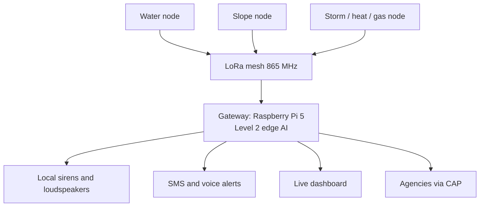

# Environet

**Last mile, first warning.**

Environet is a low-cost, solar-powered, offline-first sensor network for hyperlocal disaster early warning. It adds a ground-sensing layer beneath national systems like IMD, CWC and GSI, and delivers warnings directly to the people at risk, even when internet, power and mobile networks fail.

Built by **Team AURA**.

🔗 **Live dashboard:** https://enviro-netrep.onrender.com
*(Hosted on Render's free tier, so the first load may take up to a minute.)*

🎥 **Demo video:**https://drive.google.com/drive/folders/1xf7R-QhSi6CpGNrOdPlTFbqOB1HnU02x

---

## The problem

Every year, people in India die in disasters that could have been predicted, because warnings are too coarse, too slow, unreliable, or fail when networks go down. After disaster strikes, rescuers are left blind to where help is needed most.

## The solution

Every Environet node shares a common **base kit**, and one or two **hazard modules** are added depending on the risks at that location. One platform can serve a city underpass, a hill village, a coastal settlement or an industrial area.

| Module | Sensors | Hazards |
|---|---|---|
| Water | Ultrasonic level sensor, rain gauge | Flash floods, urban flooding, storm surge |
| Slope | Soil moisture, tilt, vibration | Landslides, debris flows |
| Storm | Lightning sensor, air pressure | Lightning, cyclones |
| Heat | Black-globe sensor (WBGT) | Humid heat stress |
| Chemical | Gas-specific electrochemical sensors | Toxic gas leaks |

## Architecture

**Two levels of edge AI:**
- **Node (ESP32-S3):** filters noise, tracks trends (rate of water rise, storm approach, gas concentration), estimates time until danger, and can sound its local siren immediately.
- **Gateway (Raspberry Pi 5):** combines data from many nodes into confidence-weighted alerts, links cascading hazards, and maps silent nodes into probable impact zones after a disaster.

## How it works

1. **Sense:** nodes read their sensors, sampling faster as risk rises.
2. **Analyse:** on-device AI calculates a risk level and time until danger.
3. **Confirm:** the gateway combines readings from neighbouring nodes into a confidence score.
4. **Warn:** sirens, loudspeakers, SMS and voice alerts in local languages.
5. **Respond:** officials must acknowledge alerts or they escalate; after a disaster, the mesh carries SOS messages and maps impact zones.

## Project status

| Feature | Status |
|---|---|
| Flood-sensing node with real-time data | ✅ Built and tested |
| LoRa transmission, node to gateway | ✅ Built and tested |
| Edge risk and confidence scoring | ✅ Built |
| Live map dashboard with trend graphs | ✅ Built |
| Multi-node mesh with rerouting | 🔄 In progress |
| Edge AI models (TinyML) | 🔄 In progress |
| Slope, storm, heat and chemical modules | 📋 Planned |
| Silence-as-a-signal, alert acknowledgement, disaster mode, CAP alerts | 📋 Planned |

## Tech stack

- **Hardware:** ESP32-S3 N16R8, LoRa (865–867 MHz), solar power, environmental and hazard sensors
- **Gateway:** Raspberry Pi 5, LoRa, 4G/GSM
- **Firmware:** Embedded C/C++, lightweight JSON API
- **Dashboard:** HTML, CSS, JavaScript, Leaflet.js
- **Backend:** REST APIs
- **AI (planned):** TinyML on nodes, anomaly detection and hazard correlation at the gateway

## Estimated cost

| Item | Approx. cost (₹) |
|---|---|
| Average node | ~8,500 |
| Gateway | ~17,000 |
| Local pilot (15 nodes, 2 gateways) | ~1.8 lakh |

*Estimates based on small-batch retail prices in India. Replace with your actual parts cost.*
